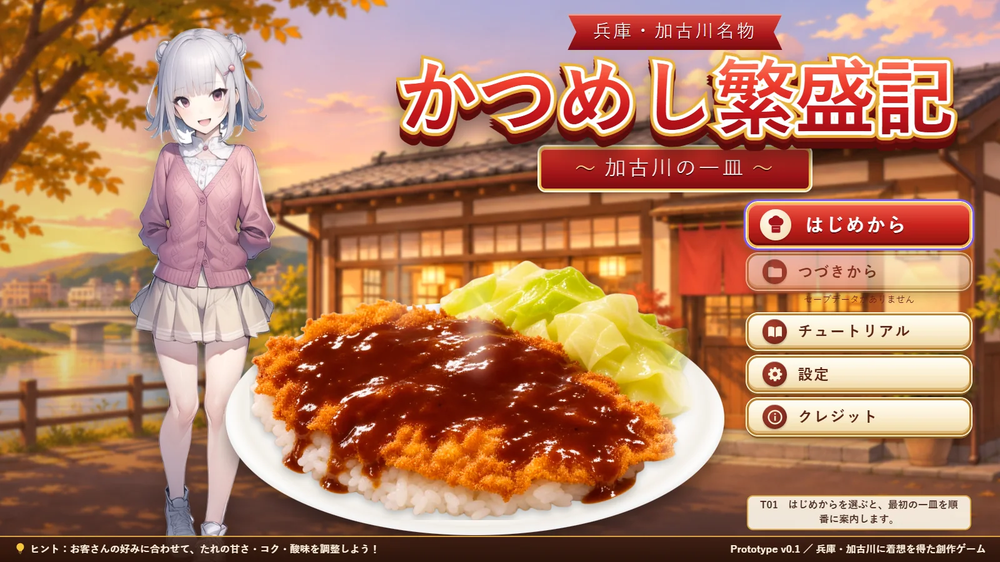
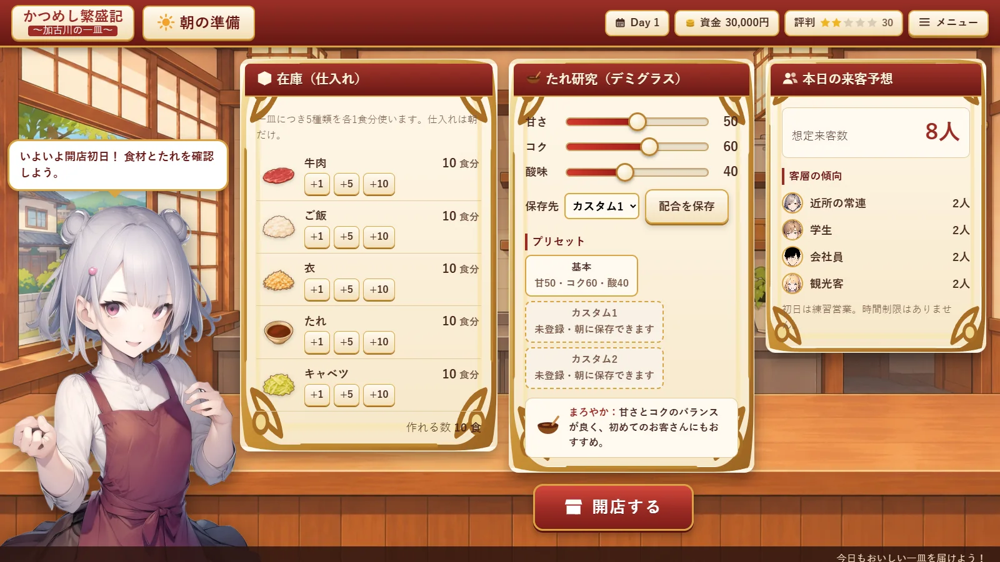
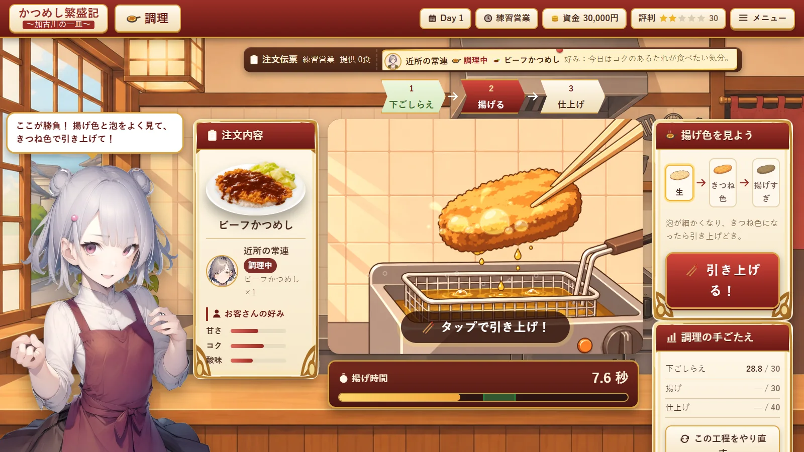
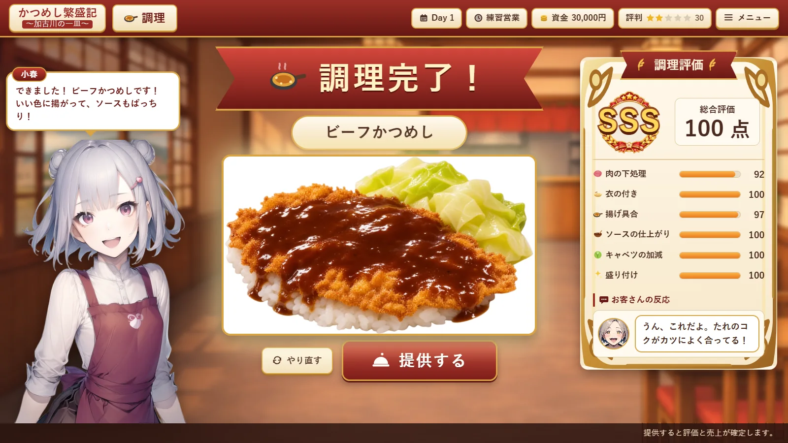
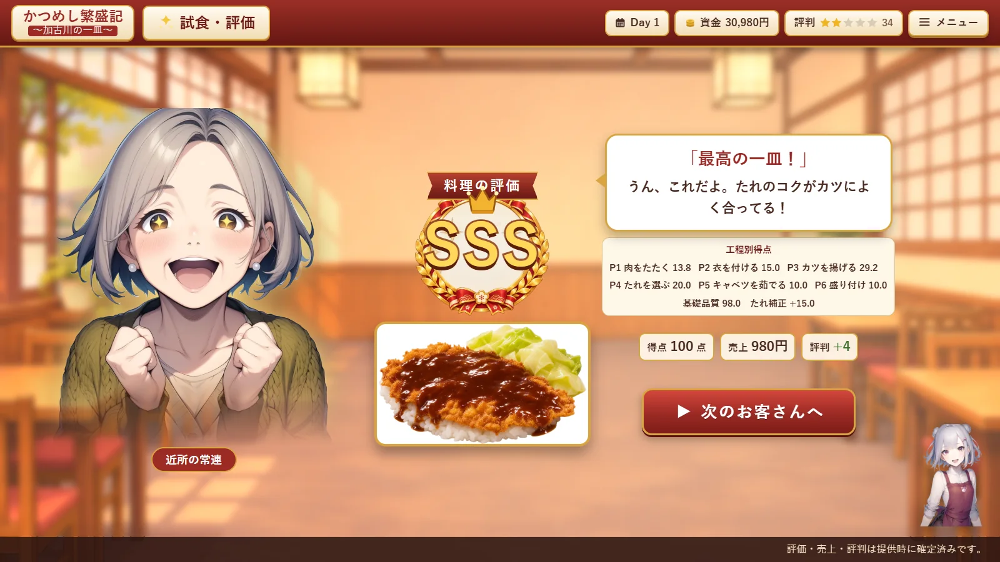
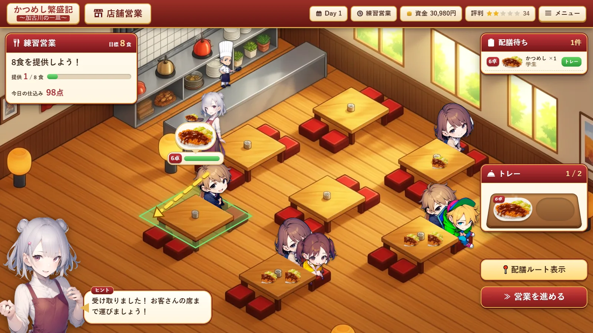

# かつめし繁盛記 ～加古川の一皿～



**揚げて、かけて、運んで。加古川名物「かつめし」で、小さな食堂を街いちばんの人気店に。**

兵庫県加古川市の郷土料理「かつめし」を題材にした、調理アクション付き店舗経営シミュレーションゲーム。

プレイヤーは小さな食堂を営み、ビフカツの下ごしらえ・衣付け・揚げ・秘伝のたれ・盛り付けを工夫しながら、お客さんの評判と売上を伸ばして地域の人気店を目指します。

ブラウザだけで動きます（インストール不要・依存ライブラリなし）。

## ゲームの流れ

| | |
| :---: | :---: |
|  |  |
| **① 朝の仕込み**<br>食材を仕入れ、たれの甘さ・コク・酸味を配合。来客予想を見て一日の準備を整えます。 | **② 調理アクション**<br>肉をたたき、衣を付け、揚げ色と泡を見極めて引き上げる。工程ごとの手ごたえが点数になります。 |
|  |  |
| **③ 今日の一皿が完成**<br>たれ選び・キャベツの茹で加減・盛り付けまで仕上げて、SSS〜Fの6段階で評価。 | **④ お客さんの反応**<br>好みに合ったかどうかが表情と台詞で返ってきます。売上と評判もここで確定。 |



**⑤ 昼営業ラッシュ：配膳フロア**<br>
仕込んだ一皿の品質で、その日の営業に挑みます。斜め見下ろしの店内で、できあがった料理をトレーに載せて（最大2皿）、待ち時間ゲージが減っていくテーブルへ運びます。どの順番で回るかが腕の見せどころ。閉店後は売上で設備を買い足し、翌日へ。

### 見どころ
- **手ざわりのある調理**：6工程それぞれに別の操作。揚げは「きつね色」の一瞬を狙うタイミング勝負。
- **たれの研究**：甘さ・コク・酸味の配合を保存して、お客さんの好みに合わせた看板だれを作れます。
- **表情豊かなお客さん**：常連、学生、会社員、観光客……好みも反応もそれぞれ違います。
- **加古川の空気感**：川沿いの夕景や、木のぬくもりのある食堂。架空の街と人物で描く、温かい店舗物語。

> スクリーンショットは開発中のプロトタイプ（2026-11-25時点、Day 1 練習営業）です。画像・音素材はレビュー中の候補を含みます。

> 状態: v0.5仕様に沿ったブラウザ操作プロトタイプを実装中（2026-11-23）。調理・店舗経営・会話・セーブの主要フローと分割アセットを接続済みです。既存キャラクター候補はComfyUI＋LoRA由来、非キャラクター画像はChatGPT画像生成を使用。ComfyUIへの新規ジョブ投入は全て停止中です。画像・音はレビュー候補のため、ライセンス確認、画面合成レビュー、ブラウザE2E、実機UI品質の受け入れは未完了です。料理の新規生成・差替えは保留しています。

## ブラウザ操作プロトタイプ（2026-11-23）

依存ライブラリ不要のES Modules版です。後にReact/PixiJSへ移行するときも `src/domain.mjs` のロジックを再利用できます。

```powershell
git clone https://github.com/yn217/Katsumeshi-Game.git
cd Katsumeshi-Game
npm run dev
```

ブラウザで `http://127.0.0.1:5173/` を開きます（Node.js 20以上推奨、npm install不要）。

```powershell
npm test
npm run audit:release
npm run build
npm run build:preview
```

- `npm test`：Node.jsの標準テストで注文/会計/調理/翌日などの計算を検証
- `npm run build`：承認済み素材だけを含む配布ビルド。実行中素材の受け入れ・権利確認が揃わない場合は停止
- `npm run audit:release`：配布素材の承認・ライセンス・sourceWorkflowを読み取り専用で確認。ファイルは生成/削除しない
- `npm run build:preview`：レビュー候補を含むローカル確認用サイトを `dist-preview/` に出力。公開しない
- **機能:** タイトル → 朝の仕込み/たれ → 通常営業と注文 → 6工程 → 評価SSS〜F → 閉店結果 → 設備購入 → 翌日、IndexedDBセーブ/ロード。チュートリアル、日別会話、音量設定とBGM/SEも実装。
- **現状:** P1〜P6は簡易操作のプロトタイプ。店主・顧客キャラ32枚はComfyUI＋LoRAで生成し参照先に接続済み。料理、背景、UI、音素材を含む受け入れレビューとブラウザE2Eは未完で、公開リリースではありません。
- **注意:** `index.html` を直接ダブルクリックせず、`npm run dev` でHTTP配信してください。ローカル保存はブラウザのIndexedDBに依存します。

実装範囲・検証結果・既知の差分は [docs/24_PROTOTYPE_IMPLEMENTATION.md](docs/24_PROTOTYPE_IMPLEMENTATION.md) を参照。

## 設計の柱
- **調理の手触り**: 1皿を短いアクションの連続で作り、出来映えが目に見えて変化する。
- **たれの研究**: 甘さ・コク・酸味の配合を研究し、店の看板メニューを生み出す。
- **キャラクターの反応**: 料理の評価が客の表情、台詞、評判に反映される。常連化による動的来客抽選はv1以降。
- **地域性**: 加古川の食文化を尊重しつつ、架空の街・人物による温かな店舗物語を描く。

## ドキュメント
| パス | 内容 |
| --- | --- |
| [docs/00_VISION.md](docs/00_VISION.md) | コンセプト・対象ユーザー・スコープ・非目標 |
| [docs/01_GAMEPLAY.md](docs/01_GAMEPLAY.md) | コアループ・進行・ゲーム状態・チュートリアル |
| [docs/02_COOKING.md](docs/02_COOKING.md) | 調理アクション・評価式・たれ研究 |
| [docs/03_MANAGEMENT.md](docs/03_MANAGEMENT.md) | 店舗経営・顧客・イベント・バランス |
| [docs/04_UI_UX.md](docs/04_UI_UX.md) | 画面遷移・画面構成・入力・アクセシビリティ |
| [docs/05_CONTENT_DATA.md](docs/05_CONTENT_DATA.md) | データ定義・レシピ・イベント・セーブ |
| [docs/06_ART_ASSETS.md](docs/06_ART_ASSETS.md) | ビジュアル方針・アセット規格・既存キャラクター候補の由来 |
| [docs/07_TECHNICAL.md](docs/07_TECHNICAL.md) | Web実装案・アーキテクチャ・性能目標 |
| [docs/08_ROADMAP_QA.md](docs/08_ROADMAP_QA.md) | MVP工程・Issue分割・検証・受け入れ基準 |
| [docs/09_REFERENCES.md](docs/09_REFERENCES.md) | 郷土料理の事実確認・資料・権利について |
| [docs/10_SPEC_REVIEW.md](docs/10_SPEC_REVIEW.md) | 仕様レビュー・修正履歴・未解決事項 |
| [docs/11_UI_MOCKUPS_V03.md](docs/11_UI_MOCKUPS_V03.md) | 新キャラクターを反映したUIモックアップ v0.3 のレビューと管理 |
| [docs/12_MVP_SIMULATION_SPEC.md](docs/12_MVP_SIMULATION_SPEC.md) | 来客スケジュール、時間処理、注文、閉店 |
| [docs/13_SCREEN_INTERACTION_SPEC.md](docs/13_SCREEN_INTERACTION_SPEC.md) | 画面別操作、ボタン、遷移、エラー |
| [docs/14_COOKING_INPUT_CONTRACT.md](docs/14_COOKING_INPUT_CONTRACT.md) | 調理6工程の具体的入力・採点 |
| [docs/15_NARRATIVE_CHARACTER_AUDIO.md](docs/15_NARRATIVE_CHARACTER_AUDIO.md) | 主人公・顧客・物語・台詞・音 |
| [docs/16_SAVE_DATA_AND_BALANCE.md](docs/16_SAVE_DATA_AND_BALANCE.md) | セーブ契約、食材単位、会計、救済 |
| [docs/17_ASSET_PRODUCTION_PLAN.md](docs/17_ASSET_PRODUCTION_PLAN.md) | UI分割・アセット制作・既存キャラクター候補の生成記録 |
| [docs/18_REVIEW_V04.md](docs/18_REVIEW_V04.md) | レビュー指摘と実装残課題 |
| [docs/19_REVIEW_V05.md](docs/19_REVIEW_V05.md) | 第3回横断レビューと修正記録 |
| [docs/20_EVENT_STATE_PROTOCOL.md](docs/20_EVENT_STATE_PROTOCOL.md) | 状態遷移・コマンド処理・保存規約 |
| [docs/21_BALANCE_AND_PLAYER_EXPERIENCE.md](docs/21_BALANCE_AND_PLAYER_EXPERIENCE.md) | 進行、ゲーム体験、バランス試験 |
| [docs/22_UI_ACCESSIBILITY_AND_INPUT.md](docs/22_UI_ACCESSIBILITY_AND_INPUT.md) | 画面状態・入力・アクセシビリティ |
| [docs/23_QA_RELEASE_CONTRACT.md](docs/23_QA_RELEASE_CONTRACT.md) | 単体/E2E/アセット受け入れ試験 |
| [docs/24_PROTOTYPE_IMPLEMENTATION.md](docs/24_PROTOTYPE_IMPLEMENTATION.md) | 実装状況・既知の差分・次の開発優先順位 |
| [docs/25_ASSET_REQUIREMENTS_AUDIT.md](docs/25_ASSET_REQUIREMENTS_AUDIT.md) | 仕様に対するアセット生成/受け入れ監査 |

## MVP（最初に動かすもの）
- ブラウザでタイトル→1日の仕込み→開店→8件の注文→結果→翌日の流れを遊べる
- 基本ビーフかつめし1種、たれ3パラメータ、異なる嗜好を持つ客4種
- カツ調理6工程（採点5工程＋たれ選択1工程）、品質評価、食後リアクション、売上・評価・セーブ
- マウス操作中心。既存キャラクター候補はComfyUI＋LoRA由来。新規画像は非キャラクターのみChatGPT画像生成を使い、ComfyUIジョブは投入しない

## 設計ルール
仕様と実装を区別する。未検証の数値には「暫定値」を明記する。実在店舗・実在人物・観光協会の公式キャラクター／ロゴの無断利用はしない。

## 開発
初期案は Vite + TypeScript + React（UI）+ PixiJS（2D演出）、ローカルセーブ。ゲームの品質検証を優先し、Godot等への移行は必要性を評価した後に判断する。

## v0.2の共通決定事項
初日は8注文・制限時間なし、通常日は600秒、客の待機時間は基本180秒。**待機客だけ忍耐が減り、調理中はその注文の待ち切れなし。試食リアクション中は時計停止。閉店時間後も残注文を処理する**。食材は注文を受けた時点で消費し、売上は提供時に一回だけ確定する。変更箇所と追加検討事項は[レビュー記録](docs/10_SPEC_REVIEW.md)参照。

## 実装に用いる仕様の優先順位（v0.4）
従来の企画書00〜11を残しつつ、細部の具体的な操作・時間・計算・保存契約は [12〜18の実装規範](docs/18_REVIEW_V04.md) を優先する。初期数値の唯一の機械可読ソースは [spec/mvp_config.json](spec/mvp_config.json) とする。仕様のレビューで不足を補っただけでゲーム本体の実装・動作試験が完了したわけではない。

**ゲームの顔**: 指定された銀髪・双お団子・ピンク色の瞳とヘアピンの主人公。元参照画像の衣装は使用せず、食堂の店主役としてデザインする。料理を評価するのは注文した顧客。モックアップは構図の参考であり、実装では背景/人物/料理/ボタンを分ける。

## v0.5で確定した追加実装ルール
- 設備unlockDayは**効果が発生する最初の営業日**。その前日の閉店後UPGRADEから購入可。Day1結果後はDay2用フライヤーを購入できる。
- 不足在庫への無償支援は**各品を最低4食分まで補う**もので、既にある材料に4食分を無条件加算しない。
- Day1の最初の注文は一度提供・試食を見せるまでキャンセル不可。以降はキャンセル可能。
- UI文字は画面画像とは別レイヤーでCSS表示。1280×720でも18px程度の主要文字サイズを維持。
- [spec/mvp_config.schema.json](spec/mvp_config.schema.json)・[spec/mvp_save.schema.json](spec/mvp_save.schema.json)・[spec/mvp_save_example.json](spec/mvp_save_example.json) でデータ型を検証する。[scripts/validate_specs.py](scripts/validate_specs.py)を使った静的チェックは実行可能な準備が整った段階で検証する。

**仕様優先順位:** v0.5の[19](docs/19_REVIEW_V05.md)を参照。v0.4の旧説明・v0.3の画像に矛盾する値があれば20〜23とspec JSONを優先する。ゲームコードはブラウザ操作プロトタイプとして実装済みで、全受け入れE2E・アセット採用審査・リリース判定は未完了です。検証状況は[docs/23_QA_RELEASE_CONTRACT.md](docs/23_QA_RELEASE_CONTRACT.md)と[docs/24_PROTOTYPE_IMPLEMENTATION.md](docs/24_PROTOTYPE_IMPLEMENTATION.md)を参照してください。
